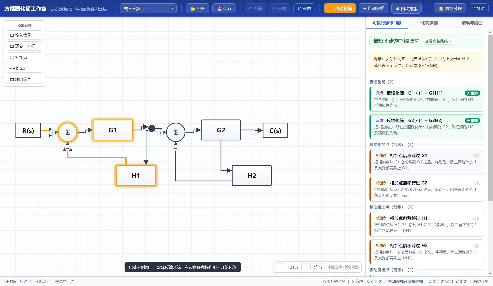
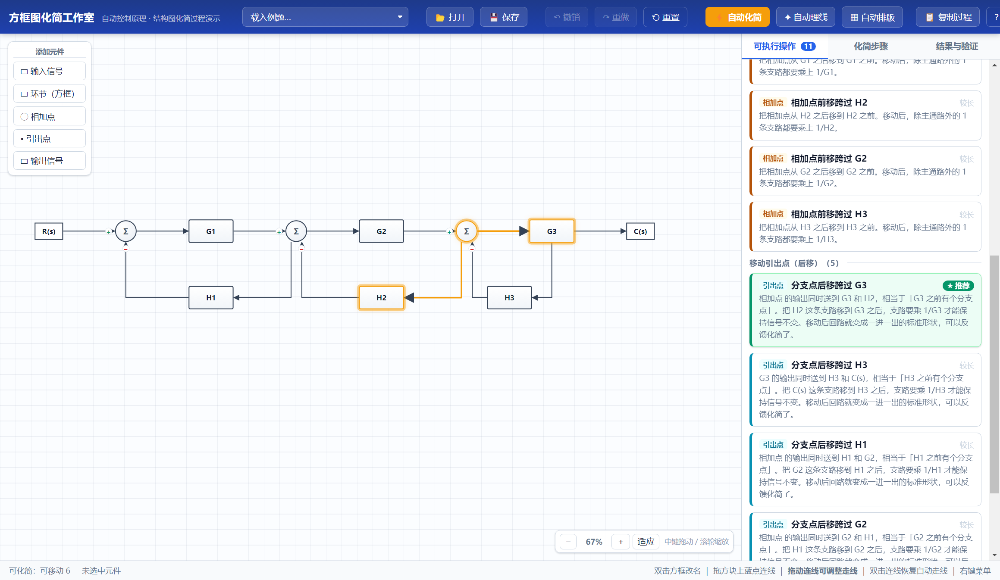
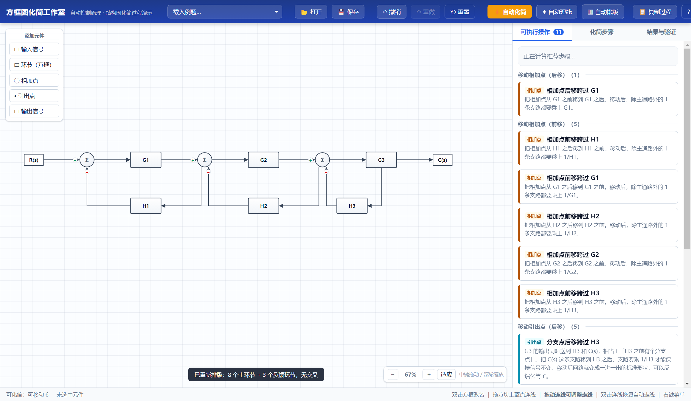

# 方框图化简工作室

[](https://github.com/Oxygen640/block-diagram-studio/actions/workflows/test.yml)
[](https://github.com/Oxygen640/block-diagram-studio/releases)
[](https://github.com/Oxygen640/block-diagram-studio/blob/main/LICENSE)

> 面向《自动控制原理》「系统结构图的化简」一节的教学演示程序。
> **重点是把"化简过程"演出来**：每一步做了什么、为什么这么做，都会记下来。



> **界面一览** —— 左边画结构图，右边是可执行操作。
> 绿色框 + ★ 推荐 的那一项，就是程序算出的"从当前这张图走到最简形式的最短路线"的下一步，
> 点完会自动算出新的下一步，可以一路跟着点到底。



> **自动排版** —— 点 ▦ 自动排版，主回路从左到右铺开、反馈环节排到下面一行，
> 输入在最左、输出在最右，零交叉零重叠。



---

## 快速上手（3 步）

1. 双击 `dist\方框图化简工作室-安装包-1.0.0.exe` 安装（可以自选目录）
2. 打开程序 → 顶栏「载入例题」选 **例题一：双环反馈系统**
3. 右边「可执行操作」里**绿色框住的那一项就是程序推荐的下一步**，点它；点完程序会立刻算出新的下一步
   —— 也可以直接点顶栏的 **⚡ 自动化简**

> 碰到不会做的题（多个回路互相咬在一起那种），就一路跟着 ★ 推荐点下去。
> 程序在后台算出的是"从当前这张图走到最简形式的最短路线"，并且每一步都经过数值校验，
> 保证不会把传递函数改掉。

---

## 一、安装与运行

> **从 GitHub 克隆下来的仓库里没有 `dist/`**（打包产物被 `.gitignore` 忽略了，
> 因为里面有 300 MB+ 的 Electron 运行时）。三条路选一条：
>
> | 你想做什么 | 怎么做 |
> | --- | --- |
> | 只想先看看界面 | **方式三**，`npm install` 后 `npm start` |
> | 想要安装包发给别人 | `npm install` → `npm run dist`，装出来的在 `dist/` 里 |
> | 从 Releases 下载 | 如果作者在 GitHub Releases 里挂了安装包，直接下那个 |

### 方式一：安装包（推荐）

双击 `dist\方框图化简工作室-安装包-1.0.0.exe`：

1. 可以自选安装目录（不会偷偷装到 C 盘）
2. 自动创建桌面快捷方式和开始菜单项
3. 装好后双击桌面图标即可运行

> 安装包没有数字签名，Windows 可能弹出「SmartScreen 已阻止」。
> 点「更多信息」→「仍要运行」即可 —— 这是所有未签名小软件的通用提示。
> 卸载用控制面板「添加或删除程序」，或者开始菜单里的卸载项。

### 方式二：免安装绿色版

直接运行 `dist\win-unpacked\BlockDiagramStudio.exe`，不用安装。
整个 `win-unpacked` 文件夹拷到 U 盘也能用。

### 方式三：从源码运行

```powershell
npm install
npm start
```

> **注意**：npm 11 默认会拦下 Electron 的安装脚本。如果 `npm install` 之后
> 运行报 "Electron failed to install correctly"，执行一次：
> ```powershell
> node node_modules\electron\install.js
> ```

---

## 二、要发给朋友什么（打包建议）

**朋友真正需要的只有安装包这一个文件：**

```
dist\方框图化简工作室-安装包-1.0.0.exe     ← 77.9 MB，双击即装
```

只发这一个就够了。可以顺手把 `dist\安装说明.txt` 一起发过去。

### 不建议整个文件夹打包

这个项目文件夹里有 800 MB 以上，其中绝大部分是**开发用**的，朋友拿到没用：

| 目录 | 大小 | 要发给朋友吗 |
| --- | --- | --- |
| `dist\方框图化简工作室-安装包-1.0.0.exe` | 78 MB | ✅ **就发这个** |
| `dist\win-unpacked\` | 268 MB | 可选（免安装版，想免安装的朋友才需要） |
| `node_modules\` | 543 MB | ❌ 开发依赖，`npm install` 可以重新装 |
| `src\` `electron\` `build\` `_test\` | < 1 MB | ❌ 源码和测试，除非朋友想自己改代码 |
| `package.json` `package-lock.json` | 0.2 MB | ❌ 同上 |

**如果要发给懂技术的朋友看源码**：把 `node_modules` 和 `dist\win-unpacked`
删掉再打包，整个文件夹只剩 80 MB 左右，对方 `npm install` 就能接着开发。

---

## 三、界面速览

```
┌──────────────────────────────────────────────────────────────────────────────┐
│ 载入例题 │ 打开 保存 │ 撤销 重做 重置 │ ⚡自动化简 │ ✦自动理线 ▦自动排版 │ 复制过程 │
├────────────────────────────────────────────┬─────────────────────────────────┤
│  添加元件                                   │ 可执行操作 (8)                  │
│   ▭ 输入信号                                │  ┌─ 最短 5 步即可化到最简 ─────┐│
│   ▭ 环节（方框）                            │  │  查看完整路线 ▾             ││
│   ◯ 相加点          ┌───┐    ┌───┐          │  └─────────────────────────────┘│
│   • 引出点          │G1 │──▶ │G2 │──▶       │  ├ ★推荐 反馈化简：G1/(1+G1H1)  │
│   ▭ 输出信号        └───┘    └───┘          │  ├ 还需 3 步 移动相加点（后移） │
│                        ▲────────┘           │  ├ 较长   移动引出点（后移）    │
│                                             ├─────────────────────────────────┤
│                                             │  化简步骤 ① ② ③ ...             │
│                                             │  （点任意一步可以回退）          │
├────────────────────────────────────────────┴─────────────────────────────────┤
│ 可化简：反馈 2，可移动 6     已选中：环节「G1」        − 79% ＋ 适应  中键拖动/滚轮缩放 │
└──────────────────────────────────────────────────────────────────────────────┘
```

右边三个标签页：

| 标签页 | 作用 |
| --- | --- |
| **可执行操作** | 当前这张图上所有能做的化简/移动操作（**已经滤掉会改变传递函数的那些**），点一下就执行；**顶部直接告诉你最短几步能化到底、下一步该走哪一步**；**鼠标悬停在某项上时，画布上相关的方框和连线会高亮** |
| **化简步骤** | 已经做的每一步，点任意一步可以回退重做 |
| **结果与验证** | 给出总传递函数的**分式形式**、**LaTeX 代码**和**展开式**，并可导出图片；同时用梅森公式独立核对 |

---

## 四、支持的化简操作

### 三种基本等效变换

| 变换 | 结构 | 等效结果 |
| --- | --- | --- |
| **串联** | `G1` 与 `G2` 串联 | `G1G2` |
| **并联** | `G1` 与 `G2` 并联后在相加点相加 | `G1 + G2` 或 `G1 − G2`（符号取自相加点） |
| **反馈** | 前向 `G`、反馈 `H` | 负反馈 `G/(1+GH)`，正反馈 `G/(1−GH)` |

### 两种「移动」——**这是很多题必须先做的一步**

| 操作 | 做法 | 补偿 |
| --- | --- | --- |
| **相加点后移**（跨过 G） | 相加点从 G 前移到 G 后 | 其余支路各 **乘 G** |
| **相加点前移**（跨过 G） | 相加点从 G 后移到 G 前 | 其余支路各 **乘 1/G** |
| **引出点后移**（跨过 G） | 引出点从 G 前移到 G 后 | 其余引出支路各 **乘 1/G** |
| **引出点前移**（跨过 G） | 引出点从 G 后移到 G 前 | 其余引出支路各 **乘 G** |

> 记忆口诀：**相加点后移乘 G、前移乘 1/G；引出点正好相反。**
> 程序会在每一步的说明里写清楚"哪条支路要乘什么"，不用死记。

### 另外还支持

- **合并相邻相加点** —— 两个相加点串在一起（前一个的输出就是后一个的输入）时，本质上是同一个相加点。
  **这一步教材上一般是"心算"掉的，但程序必须显式做**，否则后面的反馈化简根本认不出回路。
- **去掉多余的相加点 / 引出点** —— 化简到最后常常剩下一个只有一个输入（或只有一条出线）的节点，
  它已经不起作用了，删掉即可。
- **分支点后移跨过方块** —— 相加点兼作引出点时专用，做完立刻变成标准的一进一出结构
- **交换相邻相加点** —— 不改变传递函数，但常常能"凑"出可化简的结构
- **交换相邻引出点**

> 这几条看起来不起眼，却是"**这道题明明能化，软件却说化不了**"的常见原因。
> 详见下面例题三。

---

## 五、推荐步骤：程序会告诉你"下一步该走哪一步"

化简一道题往往有好几条路：**先合并哪个回路、要不要先搬引出点**，走错一步后面全是死胡同。
这一栏就是替你把这条路先算出来。

### 它是怎么算的

1. **先筛掉不能用的操作。**
   框图化简的每条基本变换都有适用条件。条件不满足时硬套公式，图看着像模像样，
   传递函数其实已经变了 —— 这是最坑人的错误。
   程序不靠"一条条写 if 判断适用条件"（那样一定会漏），而是**数值验证**：
   把框图翻译成信号流方程，在几个不同的取值点上分别解出 `C/R`，
   化简前后只要有一个点对不上，这条变换就直接从列表里拿掉。见 `src/verify.js`。
2. **再搜最短路线。**
   以"当前结构图"为状态、以"执行一个合法操作"为一步做广度优先搜索，
   目标是化到只剩一个环节。第一层搜到的解就是步数最少的。见 `src/planner.js`。
3. **同样步数下挑最干净的。**
   给每类操作标一个"丑度"：串联／并联／反馈最便宜，搬相加点／引出点贵，
   搬完还引入 `1/G2` 这类分式方块的最贵。于是同样是 5 步的走法，
   程序会优先推荐那条一路合并下来的，而不是把方块搬来搬去的。

### 界面上长什么样

- 操作面板顶部一条绿色结论：**「最短 N 步即可化到最简」**，点 **查看完整路线** 可以展开整条路线。
- 推荐的操作用**绿框 + ★ 推荐**标出，并自动排到它所在那一组的最前面。
- 其余操作标 **还需 N 步**；算不出确切步数的标 **较长**，表示"走它不会更短"。
- 点一下推荐的那一步，程序立刻重新规划下一步 —— 可以一路跟着点到底。

> 大图（十几个元件、多个回路）搜索要几秒钟，程序把搜索切成小片跑，
> 界面上先显示「正在计算推荐步骤…」，算完自动刷新，**不会卡死**。

---

## 六、内置例题

| 例题 | 说明 |
| --- | --- |
| **例题一：双环反馈系统** | 经典双回路，`C/R = G1G2/((1+G1H1)(1+G2H2))`，直接点操作就能化简 |
| **例题二：需要移动引出点** | 引出点取在 G2 输出，必须先移动引出点才能化简 |
| **例题三：并联＋反馈** | `C/R = (G1+G2)/(1+G2G3)`，两路信号在回路内部交汇，必须先**合并相邻相加点** |
| **空白画布** | 自己从零画图 |

也可以点顶栏 **📂 打开** 载入之前用 **💾 保存** 存下来的图纸（`.json`）。

### 例题三：为什么"看着能化，程序却说不能"

```
R(s) → •T1 ─┬─→ G1 ──────────→ ⊕top ─→ •T2 ─→ C(s)
            │                     ↑          │
            └─→ ⊕low ─→ G2 ──────┘          │
                  ↑                          │
                  └──── G3 ←────────────────┘
```

`G3` 的反馈回到 `⊕low`，而 `G1` 又直接灌进 `⊕top` —— 两路信号在**回路内部**交汇。
直接套 `G/(1+GH)` 是错的（`G1` 会被卷进回路里）。正确路线是：

1. **相加点后移跨过 G2** —— 把 `⊕low` 挪到 `G2` 后面（另一路要乘 `G2`）
2. **合并相邻相加点** —— 这时 `⊕low` 和 `⊕top` 已经串在一起了，并成一个
3. 并联合并 `G1 + G2`
4. 反馈化简 `1/(1+G2G3)`
5. 串联化简
6. 去掉多余的引出点

跟着 ★ 推荐走就是这 6 步。每一步的 `C/R` 都经过数值校验，和原图完全一致。

### 一道"硬骨头"：三个回路互相咬在一起

最经典的那种三环题：

```
R → ⊕ → G1 → ⊕ → G2 → ⊕ → G3 → C
     ↑-H1    ↑-H2    ↑-H3
```

`H2` 的引出点取在第三个相加点的输出上，那个相加点同时又是 `H3` 的反馈汇入点 ——
**两个回路共用一个相加点**，谁也不能先化简。这种题单靠串联／并联／反馈是走不动的，
必须先做一次「引出点后移」把 `H3` 的引出点挪到 `G3` 之前，让最内层变成一个标准回路。

跟着 ★ 推荐走，程序给出的是 **6 步**：

```
1. 分支点后移跨过 G3      ← ★ 推荐的第一步
2. 反馈化简：G3/(1+G3H3)
3. 串联化简：G2 · G3/(1+G3H3)
4. 分支点后移跨过 G2·(G3/(1+G3H3))
5. 反馈化简（H2 回路）
6. 反馈化简（H1 回路）
```

每一步的传递函数都经过数值校验，和原图完全一致（`node _test/verify-plan.cjs 图.json` 可以自己验）。

---

## 七、画图与整理

### 基本操作

| 操作 | 说明 |
| --- | --- |
| 拖动方块 | 移动位置 |
| **双击方块** 或按 `F2` | 改名字（例如 `G1`、`K`、`1/(Ts+1)`） |
| 拖方块上的**端口小圆点** | 连线（四边都能拉线） |
| **拖动连线中间的拐线段** | 手动调整走线（拖竖直段请左右拖，拖水平段请上下拖） |
| **双击连线** | 恢复自动走线 |
| 点相加点旁边的 `+` / `−` | 切换反馈正负号（**最容易画错的地方**） |
| **右键方块 / 连线** | 弹出菜单：重命名、删除、改端口方位、切换符号、恢复自动走线 |
| 左上角工具栏 | 添加输入、环节、相加点、引出点、输出 |
| **鼠标中键拖动** | 平移画布 |
| **滚轮** | 以鼠标位置为中心缩放 |
| 右下角 `− / ＋ / 适应` | 缩放按钮 |

快捷键：`Ctrl+Z` 撤销、`Ctrl+Y` 重做、`F2` 重命名、`Delete` 删除选中、
`Ctrl+=` 放大、`Ctrl+-` 缩小、`Ctrl+0` 适应窗口、`Esc` 取消连线。

### 连线是横平竖直的，而且不会重叠

所有连线都是**正交折线**（只有水平段和竖直段），绝对不会出现斜线：

- 出线沿端口外法线方向引出，入线沿外法线方向接入（箭头正对端口）
- 自动走线会**尽量避开其它方块**
- **先走的线会被后面的线当成障碍** —— 两条线不会压在一起
- 拐弯越少、长度越短、和别的线压得越少，优先级越高

> 为什么特别在意"重叠"？因为交叉只是两条线打个叉，还能看出是两条；
> 而**重叠是两条线合成一条**，根本分不清谁是谁，读图会很痛苦。
> 所以程序宁可让某条线多绕一点，也不让它跟别的线贴在一起。

自动走线不理想时，直接**拖动中间那段线**调整；双击连线可以恢复自动走线。

### 自动理线怎么挑方位：让整张图弯折最少
顶栏的 **✦ 自动理线** / **▦ 自动排版** 会做一次**全局优化**：
把每条连线两端的端口方位当作变量，反复微调，直到整张图的评分不再下降。

评分 = **弯折次数** × 1000 + **折返（毛刺）** × 3000
     + 重叠 × 100000 + 交叉 × 5000 + 总线长 × 1

几条权重都是实测定下来的：

- **弯折是主要目标**，和你的直觉一致 —— 拐弯越少越干净
- **折返要重罚**：`(x,y) → (x,y+20) → (x,y+1)` 这种"先往下走 20px 又折回来"
  按弯折数只算 1 个顶点，但视觉上是根毛刺。光看弯折数会挑到它，必须单独罚
- **重叠和交叉当硬约束**（权重极大），绝不允许为了少拐一个弯就把线叠一起
- **"同一侧既有进线又有出线"** 罚一点（800，**故意低于一个弯折的 1000**）：
  这种画法读图时分不清哪根进哪根出。实测权重一旦调到 1100 以上，
  优化器宁可绕远也要躲开它，结果反而更难看 —— 所以它只当"平局判定"用

实测效果（内置例题）：

| 例题 | 弯折 | 总线长 | 重叠 | 交叉 |
| --- | --- | --- | --- | --- |
| 例题一 优化前 | 22 | 967 px | 0 | 0 |
| 例题一 优化后 | **17** | **943 px** | 0 | 0 |
| 例题二 优化前 | 15 | 1131 px | 0 | 0 |
| 例题二 优化后 | **12** | **1121 px** | 0 | 0 |

优化是一轮**局部搜索**（逐个端点试四种方位，能降分就留下），
例题一约 370 ms、例题二约 120 ms。超过 40 条边会自动跳过，保证界面不卡。
`_test/side-exp.cjs` 是当时用来定这些权重的实验台，可以复现上面的结论。

### 端口方位与等距排布

端口可以在方框的 **左 / 右 / 上 / 下** 任意一侧，位置自动分配：

- **新画的连线会自己选方位**：出线朝向目标、入线朝向来源，线最短
- **同一个方块同一侧的多个端口自动等距排开**
- **进线和出线放在同一个队列里统一排** —— 不会出现"进线和出线撞在同一点、
  看起来只有一条线"的情况

也可以手动改：

- **右键一条连线** → 分别设置这条线的「入线方位」和「出线方位」
- **右键一个方块** → 一次改掉这个方框**全部**入线 / 全部出线的方位

例如想让反馈线从相加点**右侧**进入（而参考输入从左进），
右键那条反馈线，点「入线方位」里的「右」即可。

### 自动理线 / 自动排版

顶栏有两个按钮，专治"线乱"和"位置乱"：

| 按钮 | 作用 |
| --- | --- |
| **✦ 自动理线** | 清除所有手工走线，然后**全局优化每条连线的端口方位**（目标：整张图弯折最少）。方块位置不动。 |
| **▦ 自动排版** | 在自动理线的基础上，再按信号流向重新排列元件：主回路从左到右分层排列，反馈环节统一放到下面一行。 |

两个按钮都把**"不让线重叠"**当硬约束。自己拖乱了点一下 **▦ 自动排版**
就能恢复整齐 —— 例题一、例题二、例题三排版后都是**零重叠、零交叉**。

#### 回路从哪儿断开，决定了排版好不好看

一条反馈回路，从哪条边"断开"来分层，画出来差别极大：

| 断开的位置 | 结果 |
| --- | --- |
| 断在回路中间 | 前向通路被截成两段，**信号会从右往左流**，输出方块跑到中间，反馈线横穿整张图 |
| 断在**负反馈线**上（进入相加点、符号是减号的那条） | 前向通路从左到右整齐铺开，反馈支路绕到下面一行 —— 这才是教材上的画法 |

DFS 标回边时碰巧断在哪儿是随机的，所以程序标完之后会**回头检查一遍**：
如果同一回路里还有更像"负反馈线"的边，就把断点挪过去（挪完只要还无环就采纳）。

> ⚠️ 这里有个容易写错的地方：**"更像负反馈线"必须拿当前那条回边自己的分数当基准去比**。
> 回边本身就多半是那条负反馈线，只是它不在"候选路径"里，看不到；
> 要是只跟 0 分比，随便一条"进入相加点"的普通前向边都能把它顶掉，
> 本来画得整整齐齐的图反而会被改乱。

自动排版有一条硬指标，测试里会逐张图纸核对：

- **输入方块在最左边、输出方块在最右边**（这条最能抓住"输出跑到中间"）
- **除反馈线外没有逆流的连线**（反馈线回相加点、或往下走到反馈那一行，属正常）
- **零交叉、零重叠**

#### 交叉最小化

同一个层里几个方块谁上谁下，连线交不交叉差别极大。这套做法参考了
[Eclipse ELK Layered](https://eclipse.dev/elk/reference/algorithms/org-eclipse-elk-layered.html)
（Sugiyama 分层布局的标准实现），它把"减少交叉"分成几步：

| ELK 里的名字 | 这里对应的做法 |
| --- | --- |
| Layer Sweep（层扫描） | **重心法**：把每个方块往它邻居的平均位置靠，正反各扫几遍 |
| Greedy Switch（贪心交换） | **局部搜索**：同层相邻两块交换、或把一块插到本层别处 |
| Thoroughness / 随机重启 | 不完美就**随机重启**（固定种子，保证结果可复现） |
| Feedback Edges | 反馈回路断在负反馈线上、反馈环节单独排一行 |

每个候选都**真的走一遍线**，数出交叉、重叠、弯折、线长再打分
（重叠权重最大，其次交叉，再看弯折和线长），挑最好的那个。
反馈那一行的先后次序也一起试。

判据是「**零重叠 + 零交叉**」就收工 —— 已经够干净了，再去抠弯折和线长不划算。

`node _test/layout-sweep.cjs` 会把**每张图纸、化简的每一步**都美化一次并核对：

```
══ hard ══
   ✔ 第 0 步 交叉 0，重叠 0 px，弯折 6，方块 11，耗时 74 ms   原图
   ✔ 第 1 步 交叉 0，重叠 0 px，弯折 11，方块 12，耗时 511 ms  分支点后移跨过 G3
   ✔ 第 4 步 交叉 0，重叠 0 px，弯折 10，方块 10，耗时 467 ms  分支点后移跨过 G2·(G3/(1 + G3H3))
   …
共 28 个状态，全部无交叉 ✔
```

---

## 八、结果与导出（重点看这里）

「结果与验证」页会给出：

**① 分式形式**（真正的分子在上、分母在下）

```
              G₁G₂
C(s)/R(s) = ────────────────────────────────
             1 + G₁H₁ + G₂H₂ + G₁H₁G₂H₂
```

**② LaTeX 代码**（可直接复制到 Word / Markdown / Overleaf）

```latex
\frac{C(s)}{R(s)} = \frac{G_{1}G_{2}}{1 + G_{1}H_{1} + G_{2}H_{2} + G_{1}H_{1}G_{2}H_{2}}
```

**③ 纯文本展开式**

```
分子 = G1G2
分母 = 1 + G1H1 + G2H2 + G1H1G2H2
```

### 三个导出按钮

| 按钮 | 作用 |
| --- | --- |
| **复制 LaTeX** | 把 LaTeX 代码复制到剪贴板，直接粘进作业或 Overleaf |
| **保存 .tex** | 存成 `.tex` 文件 |
| **导出图片…** | 打开导出对话框，可以选**图片宽度**（600～2400 px）、**清晰度**（1～4 倍）、**背景**（白色/透明），实时显示最终像素尺寸 |

导出的图片是标准 PNG，透明背景适合直接贴进 Word 或 PPT。
（提示：选透明背景时公式文字是深色的，贴到深色背景的文档里会看不清。）

### 展开式是真算出来的

展开式由一个内置的**符号代数引擎**（`src/rat.js`）真实算出来的：
它把传递函数表示成符号有理式，做多项式乘加、合并同类项、约分，
而不是简单地把字符串拼在一起。所以

```
(1 + G1H1)(1 + G2H2)  展开成   1 + G1H1 + G2H2 + G1H1G2H2
G2 / G2                        约分成   1
```

都会正确算出来。

#### 化简途中的展开式也要"约干净"

反馈化简会不断产出 `G/(1+GH)` 这样的分式，下一步又把它乘回去。比如

```
(G1G2G3/(1+G3H3)) × ((1+G3H3)/(G2G3))   应该约成   G1
```

如果只会约"单项式公因子"（`G2`、`G3` 这种），`(1+G3H3)` 就约不掉，
分子分母上会一路堆成 `(1+G3H3)²`、`(1+G3H3)³`……最后展开式变成

```
分子 = G1G2G3 + 2G1G2G3G3H3 + G1G2G3G3G3H3H3
分母 = 1 + G1H1 + G2H2 + 3G3H3 + 3G1H1G3H3 + ...
```

数值上其实没错（多出来的因子会自动约掉），但**谁看都会以为自己算错了**。

所以引擎里加了一个「**精确整除**」（多元多项式长除法，单项式序取先比总次数再比字典序）：

- 相乘之前先**交叉约分**：`a` 的分子对 `b` 的分母、`a` 的分母对 `b` 的分子；
- 约分时除了单项式公因子，再试一次多项式整除；**除不尽就返回 null，绝不硬除**。

现在化简到任何一步，展开式的分子分母都和原图**一模一样**：

```
原图   G1G2G3 / 1 + G1H1 + G2H2 + G3H3 + G1H1G3H3
第 1 步 G1G2G3 / 1 + G1H1 + G2H2 + G3H3 + G1H1G3H3
第 2 步 G1G2G3 / 1 + G1H1 + G2H2 + G3H3 + G1H1G3H3
第 4 步 G1G2G3 / 1 + G1H1 + G2H2 + G3H3 + G1H1G3H3
...
```

`node _test/midstate-test.cjs` 会把每张图纸的每一步都核对一遍。

> 小提示：乘积里各因子的书写顺序会按教材习惯重排（例如 `G1H1G2H2` 而不是
> `G1G2H1H2`），数值和含义完全相同。极少数情况下单项式的因子顺序和你手写的不同，
> 这是正常的。

---

## 九、符号约定

程序按教材习惯用**符号**推导，所以中间结果看起来就像手写的一样：

```
串联      G1G2
倒数      1/G2
反馈      G1/(1 + G1H1)
复合      (G1/(1 + G1H1))·G2
```

**未知的字母会被当作独立符号**，你可以随便写 `K`、`G(s)`、`Ta` 之类。
如果写成 `1/(Ts+1)` 这种带运算符的名字，整个名字会被当作一个不可分割的符号
（展开时不再拆开）—— 数学上仍然完全正确。

---

## 十、已知限制（说清楚，免得踩坑）

- 只处理**线性、单输入单输出（SISO）**系统；不支持状态空间环节、非线性环节。
- 改名、挪位置、调走线这些**排版操作不会记进化简步骤**，不污染过程记录；
  但它们会跟着「化简步骤」一起回退。
- 手工调整过走线的连线，如果在之后拖动了它两端的方块，走线**不会自动跟着重排**。
  双击这条连线即可恢复自动走线，或者点「✦ 自动理线」全部重来。
- 反馈化简要求回路是**单回路**（回路上除相加点外每个环节只有一个输入一个输出）。
  多重交叉耦合的复杂结构需要你先手工整理。
- **相加点后移时，"哪条支路算主通路"是程序自动选的**（取第一条 `+` 输入的支路）。
  选法不影响结果的正确性（已验证），但图形布局可能和你手画的习惯不一样；
  不满意可以撤销，先用「交换相加点」调整次序再移动。
- 移动引出点时，如果引出点有多条引出支路，"主线"按几何位置（最靠右那条）自动判定。
- 符号有理式会做**单项式公因子**约分、整数公因数约分，以及**多项式精确整除**约分
  （分子能被分母整除、或分母能被分子整除时直接约掉，反馈化简来回乘出来的 `(1+GH)` 就靠这一步清掉）。
  但**不做完整的多项式最大公因式分解** —— 如果分子分母含有一个"谁也不整除谁"的公共因子，那种约不掉。
  教学题里基本碰不到；万一遇到，请手工约一下。
- 回路互不接触组合最多枚举到 4 阶（教学题足够）。

---

## 十一、正确性验证

程序的核心逻辑有自动化测试，**全部通过**。

### 引擎测试（`node _test/core-test.cjs`，83 项）

关键不变量：**任何等效变换（串联/并联/反馈/移动/交换）都不能改变总传递函数**。
测试用「数值代入 + 梅森公式」独立算一遍来核对：

```
用例 1：双环反馈系统
  原始图传递函数 = G1G2 / (1 + G1H1 + G2H2 + G1H1G2H2)
  ✔ 数值等于手算答案 3.125000
  ✔ 执行「反馈化简 / 相加点后移 / 相加点前移 / 引出点后移 / 引出点前移」后传递函数都不变
  ✔ 自动化简到底只剩 1 个环节

用例 2：需要移动引出点
  ✔ 5 个移动操作，逐个执行后传递函数都不变（15.000000）
  ✔ 「移动 + 化简」走完全程后仍然不变

用例 3：基本公式
  ✔ 串联 G1 × G2 = G1G2        ✔ 倒数 1/G2
  ✔ 负反馈 G1/(1 + G1H1)   ✔ 单位负反馈 G1/(1 + G1)   ✔ 正反馈 G1/(1 − G1H1)

用例 4：符号代数（展开式）
  ✔ (1 + G1H1)(1 + G2H2) = 1 + G1H1 + G2H2 + G1H1G2H2
  ✔ 同类项会合并：G1H1 + H1G1 = 2G1H1
  ✔ G2/G2 约分成 1

用例 5：展开式 vs 按结构写
  ✔ 两种写法数值一致（3.125000 vs 3.125000）
  ✔ 例题一展开式：分子 = G1G2，分母 = 1 + G1H1 + G2H2 + G1H1G2H2
  ✔ 化简过程的每个中间状态，展开式都等于最初传递函数

用例 6：端口方位
  ✔ 存在某一侧有多个端口，且等距排开
  ✔ 同一侧的进线/出线端口互不重合
  ✔ 入线改到左/右/上/下四侧，端口位置与外法线都正确
  ✔ 所有端口改到任意一侧后，走线依然横平竖直

用例 7：连线走线
  ✔ 例题一 10 条、例题二 8 条连线全部横平竖直
  ✔ 出入线都沿端口法线方向（不会"倒着出门"）
  ✔ 例题一：总重叠 0 px，总交叉 0
  ✔ 例题二：总重叠 0 px，总交叉 0
  ✔ 把方块随意挪动后走线依然横平竖直
  ✔ 手工拖动拐线段后仍然是横平竖直
  ✔ 斜线输入会被自动矫正成折线

用例 8：操作卡片上的公式文字
  ✔ 负反馈标题写成 1 + GH
  ✔ 正反馈标题写成 1 − GH
  ✔ 并联合并标题给出具体符号（不是 ±）

用例 9：全局方位优化
  例题一：弯折 22→17，折返 0→0，交叉 0→0，重叠 0→0，总长 967→943
  例题二：弯折 15→12，折返 0→0，交叉 0→0，重叠 0→0，总长 1131→1121
  ✔ 优化后弯折数确实变少
  ✔ 优化后没有折返（毛刺）
  ✔ 优化后仍然没有重叠 / 交叉 / 斜线
  ✔ 总线长没有明显变长
  ✔ 再优化一次不再有改动（已收敛）
  ✔ 优化方位不改变传递函数
  ✔ 乱布局优化后也没有折返、没有重叠
```

### 数值守门人（`node _test/op-audit.cjs`）

把每张图上当前能生成的**每一条**操作都跑到数值校验里，报告哪些保传递函数、哪些已经变了：

```
══════ 演示图 twoLoop ══════
  小计：15 条候选，0 条非法
══════ 演示图 needMove ══════
  小计：14 条候选，0 条非法
总计：29 条候选，0 条非法
```

拿那张"硬骨头"图跑，就能看到守门人真的在干活：走一步之后，
12 条候选里有 1 条会改变传递函数，被挡住。

### 规划路线校验（`node _test/verify-plan.cjs 图.json`）

把规划器给出的路线**逐步**送进独立数值校验，确认每一步的 `C/R` 都和原图一致：

```
原图 C/R = 2.828421612
规划：最少 6 步，耗时 …
 1. ✓ 分支点后移跨过 G3          C/R = 2.828421612
 2. ✓ 反馈化简：G3 / (1 + G3H3)  C/R = 2.828421612
 …
规划路线的每一步都等价 ✓
```

### 界面自检（`npx electron _test/ui-test.js`，79 项）

用 Electron 无界面地把界面真的点一遍：

```
✔ mousedown 后方块 DOM 元素没有被重建（这是双击改名能生效的前提）
✔ 双击方块 → 弹出改名对话框，默认值正确
✔ 连线线段可以拖动，拖动后走线改变且仍横平竖直；双击连线能恢复自动走线
✔ 所有连线都是折线（路径中没有曲线命令）
✔ 画布应用了缩放变换；放大按钮 / 滚轮缩放都生效
✔ 中键按下进入平移、拖动改变视图、松开结束
✔ 每个方块四侧都有端口拉线点；相加点正负号显示正常
✔ 右键菜单弹出，含 2 行方位按钮（8 个）与重命名项，点击别处能关闭
✔ 有分式显示框，分子/分母/分数线齐全
✔ LaTeX 代码里有 \frac；三个导出按钮都在
✔ Canvas 清晰度倍数生效（800×2 = 1600px）、宽度可调（400×1 = 400px）
✔ Canvas 真的画出了内容（逐像素检查）
✔ 悬停操作时高亮相关方块与连线；移开鼠标后高亮消失
✔ 自动理线不增删连线、走线仍横平竖直、清除了手工走线
✔ 自动理线后没有连线重叠（0 px）
✔ 例题一排版后没有连线重叠（0 px）、交叉很少（0 处）
✔ 例题二排版后没有连线重叠（0 px）
✔ 全部走线一次耗时 0.32 ms（拖动时每帧都重算也不卡）
✔ 执行操作 / 自动化简 / 撤销 / 切例题 / 切标签页 / 弹窗 / 打开保存按钮
—— 以下是推荐步骤相关的检查 ——
✔ 守门人放行合法操作 / 拦下会改变传递函数的操作
✔ 界面卡片数与合法操作数一致
✔ 算出「最短 N 步」结论条、推荐步骤带「★ 推荐」且排到组首
✔ 完整路线能展开 / 收起
✔ 点推荐步骤能执行，执行后自动重新规划
✔ 一路跟着推荐点，真的能化到最简
没有捕获到任何页面错误
```

### 真实图纸自检（`npx electron _test/figure-test.js`）

把 `_test/fixtures/` 下的图纸逐张塞进界面，走一遍完整流程：

```
══ hard ══
   候选 11 条，其中合法 11（挡下 0 条）
   最短 6 步即可化到最简
   排版：弯折 6，重叠 0 px，交叉 0，总线长 2261
   ✔ 界面列出的操作数 = 合法操作数（11）
   ✔ 「⚡自动化简」不改变传递函数（0.218187 → 0.218187）
   ✔ 算出了最短路线（最短 6 步即可化到最简）
   ✔ 标出了推荐步骤：引出点 分支点后移跨过 G3 ★ 推荐
   ✔ 完整路线能展开（6 步）
   ✔ 一路跟着推荐走，每步都点得动（6 步）
   ✔ 每一步的传递函数都没变
   ✔ 最终化到最简形式（剩 3 个元件）
   ✔ 最简形式的 C/R 与原图一致
   ✔ 自动排版后输入方块在最左边
   ✔ 自动排版后输出方块在最右边
   ✔ 自动排版后没有逆流的连线
   ✔ 自动排版后没有连线重叠（0 px）
   ✔ 自动排版后交叉很少（0 处）
   ✔ 自动排版后弯折不多（6 ≤ 14）

══ parallel-user ══
   最短 6 步即可化到最简（相加点后移 → 合并相加点 → 并联 → 反馈 → 串联 → 清理）
   ✔ …（同上 15 项）

==============================================
  hard：15/15  ✔
  parallel-user：15/15  ✔

真实图纸自检全部通过 ✔
```

### 用户图纸回归（`node _test/repro-user.cjs`）

例题三（并联＋反馈）单独留了一份不依赖 Electron 的回归：
手算 `(G1+G2)/(1+G2G3)` 对不对、守门人放不放行、规划器能不能 6 步化到底、
一路跟着推荐走传递函数会不会变。

### 中间状态检查（`node _test/midstate-test.cjs`）

对每张图纸、化简的**每一步**都核对：数值 `C/R` 一致、
展开式数值一致、**展开式的分子分母和原图一模一样**（也就是真的约干净了）。

```
══ 图纸 hard.json ══
   原图 G1G2G3 / 1 + G1H1 + G2H2 + G3H3 + G1H1G3H3
   ✔ 第 1 步 分支点后移跨过 G3：G1G2G3 / 1 + G1H1 + G2H2 + G3H3 + G1H1G3H3
   ✔ 第 2 步 反馈化简：G3 / (1 + G3H3)：G1G2G3 / 1 + G1H1 + G2H2 + G3H3 + G1H1G3H3
   ✔ 第 4 步 分支点后移跨过 G2·(G3/(1 + G3H3))：G1G2G3 / 1 + G1H1 + G2H2 + G3H3 + G1H1G3H3
   …
   ✔ 整条路线每一步的展开式都约干净了

中间状态检查全部通过 ✔
```

### 截图自查（`npx electron _test/shots.js` / `_test/shot-plan.js`）

把默认界面、结果页、分式、排版前后、悬停高亮都截成 PNG 存到 `_test/shots/`，
方便人工确认视觉效果（不参与自动判定）。
`shot-plan.js` 专门截「推荐步骤」那一栏（结论条、展开的完整路线、绿色推荐卡片）。
截图脚本自带重试：Electron 的 `capturePage` 偶尔会返回空图。

---

## 十二、目录结构与重新打包

```
block-diagram-studio/
├─ README.md               本文件
├─ CHANGELOG.md            版本变更记录
├─ LICENSE                 MIT
├─ 安装说明.txt             给朋友看的简短说明（打包时会自动复制进 dist）
├─ package.json            打包配置
├─ package-lock.json       依赖锁定
├─ .gitignore
├─ .gitattributes          统一换行符（仓库里一律 LF）
├─ .github/
│   └─ workflows/
│       └─ test.yml        持续集成：每次推送自动跑引擎测试
├─ electron/
│   └─ main.js             主进程（创建窗口、单实例、外链处理）
├─ src/
│   ├─ index.html          界面骨架
│   ├─ styles.css          样式
│   ├─ rat.js              符号代数引擎（多项式 / 有理式，用于"展开式"）
│   ├─ latex.js            LaTeX 代码生成 + 分式排版 + Canvas 绘图导出
│   ├─ model.js            图数据模型 + 符号表达式运算 + 端口方位分配
│   ├─ router.js           连线走线算法（横平竖直 + 避让方块 + 支持四方位端口）
│   ├─ engine.js           化简与移动操作引擎（核心）
│   ├─ mason.js            方框图 → 信号流图 → 梅森公式（含展开式）
│   ├─ verify.js           数值守门人：判断一条变换是否保传递函数
│   ├─ planner.js          化简路线规划（分层搜索 + 步骤推荐）
│   └─ ui.js               画布渲染、交互、缩放平移、自动理线排版、推荐标记
├─ build/
│   ├─ icon.ico            程序图标
│   ├─ icon.png            图标预览
│   ├─ make_icon.py        图标生成脚本
│   └─ post-dist.js        打包后收尾（复制说明、清理调试文件）
├─ docs/
│   └─ screenshot-*.png    README 用的界面截图（由 _test 里的截图脚本生成后拷过来）
├─ _test/
│   ├─ core-test.cjs       引擎 / 符号代数 / 走线 / 方位优化测试（83 项）
│   ├─ ui-test.js          界面自检驱动（Electron，79 项）
│   ├─ ui-probe.js         在渲染进程里跑的自检脚本
│   ├─ plan-probe.js       推荐步骤那一栏的自检脚本
│   ├─ figure-test.js      把 fixtures 下的真实图纸逐张跑一遍（Electron）
│   ├─ figure-probe.js     通用图纸自检脚本（渲染进程里跑）
│   ├─ midstate-test.cjs   化简途中每一步的展开式是否和原图一致
│   ├─ repro-user.cjs      例题三（并联＋反馈）的纯 Node 回归
│   ├─ layout-sweep.cjs    每张图纸每一步排版后的交叉数扫描
│   ├─ fixtures/
│   │   ├─ hard.json           硬骨头图纸（三环互咬）
│   │   └─ parallel-user.json  例题三（并联＋反馈，要合并相加点）
│   ├─ 数值校验与实验：
│   │   ├─ tf-verify.cjs   独立的数值校验（解信号流方程算 C/R）
│   │   ├─ verify-plan.cjs 把规划出的路线逐步送进数值校验
│   │   ├─ op-audit.cjs    审计所有算子合法性的实验台
│   │   ├─ planner-test.cjs  在命令行里跑规划器的演示
│   │   └─ compare.js / side-exp.cjs   方位权重实验（可复现结论）
│   ├─ shots.js            截图脚本（人工看效果用）
│   ├─ shot-plan.js        专门截「推荐步骤」那一栏
│   ├─ shot-layout.js      生成各图纸「自动排版后」的图，用来肉眼比对排版有没有退化
│   ├─ shot-mid.js         复现"化到第 N 步再美化"的中间状态，量交叉数
│   └─ shot-user.js        截"自动排版前后"的对比图
└─ dist/                   ← 打包产物（git 已忽略，不会上传）
    ├─ 方框图化简工作室-安装包-1.0.0.exe      ← 发这个给朋友（78 MB）
    ├─ 安装说明.txt
    └─ win-unpacked/                         ← 免安装版（268 MB）
```

### 常用命令

```powershell
npm start              # 开发模式运行
npm test               # 引擎逻辑测试（83 项）
npm run test-ui        # 界面自检（79 项）
npm run test-plans     # 真实图纸逐张跑完整流程（推荐步骤 + 排版）
npm run test-audit     # 审计所有化简算子的合法性
npm run test-mid       # 化简途中每一步的展开式是否约干净
npm run test-layout    # 每张图纸每一步排版后的交叉数
npm run shots          # 截图看效果
npm run dist           # 打 NSIS 安装包
npm run dist-portable  # 只打免安装版
```

### 改代码后怎么验证

```powershell
node _test\core-test.cjs            # 引擎逻辑（不需要 Electron，最快）
node _test\op-audit.cjs             # 所有算子是否都保传递函数
node _test\midstate-test.cjs        # 途中每步的展开式是否和原图一致
node _test\repro-user.cjs           # 例题三：并联＋反馈能不能 6 步化到底
npx electron _test\ui-test.js       # 界面自检
npx electron _test\figure-test.js   # fixtures 下的真实图纸逐张跑一遍
npx electron _test\layout-sweep.cjs # 每张图纸每一步排版后的交叉数
npx electron _test\shot-plan.js     # 截图看推荐步骤那一栏
npx electron _test\shot-layout.js   # 截图看排版有没有退化
```

---

## 十三、许可

本程序为学习用途自制，代码可自由使用修改。
界面图标为程序内用 Python(Pillow) 绘制生成。

版本变更见 [CHANGELOG.md](CHANGELOG.md)。
